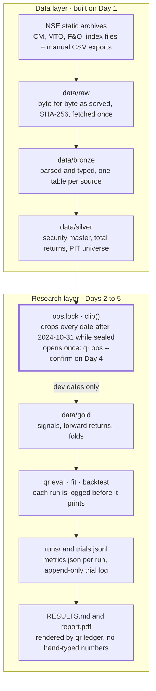

# PRD — NSE Cross-Sectional Alpha Research

Nov 9, 2026 · @Pratiksha

## 1. Summary, goals and non-goals

In 5 days, build a survivorship-free NSE daily panel. Test 8 classic signals point-in-time, combine them under purged walk-forward CV, and report net-of-cost results on a 24-month holdout read exactly once. The outputs are a repo, a RESULTS.md ledger where every number is traced to a file, and a 6–10 page LaTeX report. A null or negative out-of-sample result is a valid outcome. Report it as it is.

**Fixed decisions.** Change these only before Day 1 starts. Changing one afterwards counts as a new trial in the ledger.

| Decision | Choice | Reason |
| --- | --- | --- |
| Sample | 2012-01-02 to 2026-10-30, daily | About 3,650 sessions. Covers the 2013 taper, 2016 demonetisation, the 2018 small-cap crash and the 2020 Covid crash |
| Development window | 2013-02-01 to 2024-10-31 | The first 13 months are warm-up for 12-1 momentum |
| Locked OOS | 2024-11-01 to 2026-10-30 (24 months) | Read once, guarded by `oos.lock` (section 9) |
| Price rows kept | Series EQ, BE, BZ | Keeps prices continuous when a stock moves into trade-for-trade |
| Tradable universe | EQ or BE rows that pass the PIT liquidity filter | Removes untradable micro-caps and SME boards |
| Signal timing | Signal uses data up to close *t*. The trade fills at close *t+1* | A one-day lag kills bid-ask bounce in reversal and avoids trading at a price already used |
| Forward return | Close *t+1* to close *t+1+h*, h ∈ {1, 5, 10, 21} | The same lag in IC and in backtests |
| Primary portfolio | Long-only top decile, equal weight, weekly rebalance, vs Nifty 500 TRI | Can be implemented in the Indian cash market with no shorting |
| Secondary portfolio | Decile long-short on the PIT F&O universe, short leg in near-month stock futures | The only realistic way to hold a multi-day short |
| Model target | Cross-sectional rank of the 5-day forward return | Matches the weekly rebalance |

**Goals and how each is accepted**

| ID | Goal | Accepted when |
| --- | --- | --- |
| G1 | Survivorship-free, split- and bonus-adjusted daily panel | Delisted names are present. The adjustment check passes on 20 hand-checked corporate actions. Row counts per day are logged |
| G2 | 8 point-in-time signals | Truncating future data leaves every past signal value unchanged |
| G3 | Single-signal evaluation, raw and neutralized | An IC / rank IC / Newey-West t / ICIR / decay / turnover table and a correlation matrix exist for both versions |
| G4 | Combination: equal-weight z vs ridge vs LightGBM | All three are scored on the same purged, embargoed walk-forward folds |
| G5 | Portfolios before and after costs, plus capacity | Gross and net equity curves. The cost breakdown per component. Sharpe vs AUM curve |
| G6 | Statistical honesty | Lock file hash checked. Every run logged. Deflated Sharpe uses the logged trial count. Bootstrap CIs reported |
| G7 | Deliverables | `make report` rebuilds the PDF. Each RESULTS.md number links to a file and a git SHA |

**Non-goals**

- No live trading, broker integration, intraday data or execution simulator.
- No fundamentals, alternative data or NLP. No free point-in-time fundamentals source exists for NSE.
- No mean-variance optimizer or commercial risk model. Neutralization uses sector, beta and size only.
- No paid data, and no scraping that ignores the site's rate limits.
- Not tuning for the highest Sharpe. Reaching for a better number by adding trials is exactly what the deflated Sharpe ratio penalizes.
- Not a reusable backtesting framework. Code is plain functions over Polars frames.

**Done means** a clean clone plus the raw-data cache runs `make all` end to end. Leakage tests pass. `oos.lock` shows exactly one read. The report compiles to 6–10 pages with no number that the ledger lacks.

## 2. Architecture and repo layout

The design is a staged, file-based pipeline: raw → bronze → silver → gold → results. Every stage is idempotent, keyed by trade date, and writes a manifest. One CLI (`qr`) runs each stage. Nothing downstream of `gold` can touch dates after 2024-10-31 unless `oos.lock` allows it.



*Every number reaches the report through one lock and one ledger.*

The data layer is built on Day 1. From Day 2, every loader passes through the lock, so development code never sees a date after 2024-10-31. Every run is logged before its numbers print.

**Stack**

| Concern | Choice | Note |
| --- | --- | --- |
| Language and env | Python 3.11 with `uv` | Commit the lock file |
| Transforms | Polars lazy frames | Group-by-date ops are the hot path |
| Ad hoc queries | DuckDB over Parquet | `duckdb -c "select ... from 'data/silver/*.parquet'"` |
| Storage | Parquet with zstd, partitioned by `year` | The full panel is about 8M rows and under 1 GB |
| Downloads | `httpx` with a 1 request/s limiter, retries and an on-disk cache | Never re-download a file that is already cached |
| Statistics | `statsmodels` (HAC errors), `scipy` |  |
| Models | `scikit-learn` Ridge, `lightgbm` |  |
| Trial tracking | MLflow local file store plus an append-only `trials/trials.jsonl` | The JSONL file is the source of truth for the deflated Sharpe |
| Tests | `pytest` plus `hypothesis` for the PIT property tests |  |
| CLI | `typer` (`qr ingest`, `qr panel`, `qr signals`, `qr eval`, `qr fit`, `qr backtest`, `qr oos`, `qr ledger`) | A Makefile wraps it, because `make` is optional on Windows |
| Report | LaTeX via `latexmk` | Every number comes from a generated `numbers.tex` |

**Repo layout**

```text
nse-alpha/
├── README.md
├── RESULTS.md                 # generated by `qr ledger`, never hand-edited
├── pyproject.toml, uv.lock, Makefile
├── config/
│   ├── research.yaml          # dates, universe rules, horizons, rebalance
│   └── costs.yaml             # time-varying Indian cost schedule (section 8)
├── data/                      # git-ignored
│   ├── raw/                   # immutable, byte-for-byte as served
│   │   ├── cm_legacy/ cm_udiff/ fo_legacy/ fo_udiff/ mto/ indices/ corpactions/
│   ├── bronze/                # parsed and typed, one table per source, no logic
│   ├── silver/                # prices_adj, universe, sectors, fno_universe, fut_cont, bench
│   └── gold/                  # signals, fwd_returns, folds
├── src/qr/
│   ├── cli.py
│   ├── ingest/     download.py parse_cm.py parse_fo.py parse_mto.py corpactions.py
│   ├── panel/      adjust.py universe.py sectors.py futures.py bench.py
│   ├── signals/    registry.py momentum.py reversal.py vol.py liquidity.py ivol.py volprice.py
│   ├── eval/       ic.py neutralize.py decay.py turnover.py
│   ├── models/     cv.py ew.py ridge.py lgbm.py
│   ├── portfolio/  construct.py costs.py impact.py backtest.py capacity.py
│   ├── stats/      newey_west.py bootstrap.py dsr.py
│   ├── guard/      oos_lock.py trial_ledger.py
│   └── report/     ledger.py figures.py
├── tests/          test_parsers_overlap.py test_adjust.py test_pit_truncation.py
│                   test_cv_purge.py test_costs.py test_oos_lock.py
├── runs/<run_id>/             # config snapshot, metrics.json, artifacts (git-ignored)
├── trials/trials.jsonl        # append-only, committed
├── oos.lock                   # committed
└── report/
    ├── main.tex  sections/*.tex  refs.bib
    ├── numbers.tex            # generated: \newcommand{\OOSNetSharpe}{...}
    └── figures/               # generated
```

**Stage contract.** Each stage writes `_manifest.json` next to its output. It records input file hashes, row counts per year, the git SHA and the config hash. A downstream stage refuses to run if an upstream manifest is missing or stale. This gives you lineage for free when RESULTS.md has to cite a file.

**Number hygiene.** `qr ledger` writes `RESULTS.md` and `report/numbers.tex` from the same `metrics.json` files. A test fails the build if `report/sections/results.tex` contains a bare decimal number outside a `\Num...` macro. That is how "every number traced" is enforced rather than promised.

## 3. Data sources (checked by HTTP on 2026-11-09)

Every dataset you need is a static daily file on `nsearchives.nseindia.com`. I probed each URL pattern below, downloaded samples and read the headers. Legacy CM files end on 2024-07-05 and UDiFF files start by 2024-01-02. That six-month overlap is your parser cross-check. The old host `archives.nseindia.com` now returns 403, so use `nsearchives` for every year.

| Dataset | URL pattern | Coverage seen | Key columns | Use |
| --- | --- | --- | --- | --- |
| CM bhavcopy, legacy | `https://nsearchives.nseindia.com/content/historical/EQUITIES/{YYYY}/{MON}/cm{DD}{MON}{YYYY}bhav.csv.zip` | 200 for 2012-01-02, 2015-01-02, 2024-07-05. 404 for 2024-07-08 | SYMBOL, SERIES, OPEN, HIGH, LOW, CLOSE, LAST, PREVCLOSE, TOTTRDQTY, TOTTRDVAL, TIMESTAMP, TOTALTRADES, ISIN | OHLCV up to 2024-07-05 |
| CM bhavcopy, UDiFF | `https://nsearchives.nseindia.com/content/cm/BhavCopy_NSE_CM_0_0_0_{YYYYMMDD}_F_0000.csv.zip` | 200 for 2024-01-02, 2024-07-05, 2026-11-06. 404 for 2020-01-02 | TradDt, ISIN, TckrSymb, SctySrs, OpnPric, HghPric, LwPric, ClsPric, LastPric, PrvsClsgPric, TtlTradgVol, TtlTrfVal, TtlNbOfTxsExctd | OHLCV from 2024-07-08 |
| Delivery position (MTO) | `https://nsearchives.nseindia.com/archives/equities/mto/MTO_{DDMMYYYY}.DAT` | 200 for 2012-01-02, 2015-01-02, 2026-11-06 | Record type 20: symbol, series, quantity traded, deliverable quantity, % deliverable. Skip the 4 header lines | Delivery-ratio signal |
| Full bhavcopy with delivery | `https://nsearchives.nseindia.com/products/content/sec_bhavdata_full_{DDMMYYYY}.csv` | 200 for 2020-01-02. 404 for 2018-01-01 | Adds AVG\_PRICE, DELIV\_QTY, DELIV\_PER. Header fields have leading spaces | Cross-check MTO only |
| F&O bhavcopy, legacy | `https://nsearchives.nseindia.com/content/historical/DERIVATIVES/{YYYY}/{MON}/fo{DD}{MON}{YYYY}bhav.csv.zip` | 200 for 2012-01-02, 2015-01-02. End date assumed 2024-07-05; confirm on Day 1 | INSTRUMENT (keep FUTSTK), SYMBOL, EXPIRY\_DT, CLOSE, SETTLE\_PR, CONTRACTS, VAL\_INLAKH, OPEN\_INT | Futures short leg, PIT F&O universe |
| F&O bhavcopy, UDiFF | `https://nsearchives.nseindia.com/content/fo/BhavCopy_NSE_FO_0_0_0_{YYYYMMDD}_F_0000.csv.zip` | 200 for 2024-07-05, 2026-11-06 | FinInstrmTp (keep STF), TckrSymb, XpryDt, ClsPric, SttlmPric, OpnIntrst, TtlTradgVol, TtlTrfVal, NewBrdLotQty | Same |
| All index closes | `https://nsearchives.nseindia.com/content/indices/ind_close_all_{DDMMYYYY}.csv` | 200 for 2013-01-02 through 2026-11-06. 404 for 2012-01-03 | Index Name, Closing Index Value, P/E, P/B, Div Yield | Nifty 500 benchmark and approximate TRI |
| Corporate actions | NSE corporate actions page, "Download (.csv)" export, one file per calendar year | The JSON behind the page returned 2,012 rows for 2018, 62 of them split, bonus or rights | SYMBOL, SERIES, SUBJECT, EX-DATE, RECORD DATE, ISIN | Split and bonus adjustment |
| Sector labels | `https://nsearchives.nseindia.com/content/indices/ind_nifty500list.csv`, plus the other `ind_*list.csv` files | Current snapshot only: 501 rows, 20 industries | Company Name, Industry, Symbol, Series, ISIN Code | Sector neutralization |
| Listed securities | `https://nsearchives.nseindia.com/content/equities/EQUITY_L.csv` | Current snapshot | SYMBOL, SERIES, DATE OF LISTING, ISIN NUMBER, FACE VALUE | ISIN and symbol master |
| Lot sizes | `https://nsearchives.nseindia.com/content/fo/fo_mktlots.csv` | Current only | Lot per expiry month | Sanity checks. Historical lots come from `NewBrdLotQty` in UDiFF |

**What the samples showed**

- **`PREVCLOSE` is not adjusted on the ex-date.** IRCTC's 1:5 split (ex 2021-10-28) shows PREVCLOSE 4130.15, the raw prior close. Infosys's 1:1 bonus (ex 2018-09-04) shows 1434.25, also raw. You cannot infer adjustments from PREVCLOSE. They must come from the corporate-actions file.
- **Split subjects parse cleanly.** For example: `Face Value Split (Sub-Division) - From Rs 10/- Per Share To Rs 2/- Per Share` and `Bonus 1:1`. Rights issues use `Rights 3:16 @ Premium Rs 238/-`.
- **UDiFF CM mixes asset types.** On 2026-11-06 the 3,715 rows held EQ 2,746, SM (SME) 384, BE 201, BZ 33, plus gold bonds and G-secs, all tagged `FinInstrmTp=STK`. Filter on `SctySrs`, never on instrument type.
- **The F&O stock universe is small.** It had 218 underlyings with 3 expiries on 2026-11-06, and 145 underlyings on 2015-01-02. That drives the long-short design in section 8.
- **Expiry dates move.** The November 2026 stock expiry is 2026-11-23, not a fixed weekday. Always read `XpryDt` / `EXPIRY_DT` from the file. Never compute it.

**Download etiquette.** Allow at most 1 request per second, with 3 retries and exponential backoff. Run after 19:00 IST or at weekends. Identify your client honestly in the User-Agent. Store each file byte-for-byte under `data/raw/` with its SHA-256 and never fetch it twice. About 3,700 sessions × 3 files is roughly 11,000 requests, about 3.5 hours. Start the download on the evening before Day 1. Request every weekday. A weekday that still returns 404 after retries is logged as a holiday. Check that each year has 245–252 sessions. Corporate actions and sectors are a one-time manual export from the website, about 15 files. Do not script NSE's cookie-gated JSON APIs.

**Fallbacks, in order**

1. **Shorter sample.** Start in 2016 instead of 2012. That cuts the download by about 30% and still leaves about 8.7 development years.
2. **Wrappers of the same archives.** `jugaad-data` and `nselib` handle the formats for you. They hit the same host, so they do not help if the host blocks you.
3. **BSE bhavcopy.** Also survivorship-free, with the same UDiFF layout since 2024. I have not verified it; probe it on Day 0 if NSE fails.
4. **Public mirrors** such as Kaggle dumps of NSE bhavcopies. Check the licence. Diff 20 random days against files you fetched from NSE yourself before trusting one.
5. **Last resort: yfinance `.NS` tickers.** These are survivorship-biased, because delisted names are missing. If you use them, drop every "survivorship-free" claim from the report and the resume bullets.

**Benchmark.** Nifty 500 TRI: download it once by hand from niftyindices.com historical data (Total Returns Index). If that fails, approximate it from `ind_close_all` as TRIₜ = TRIₜ₋₁ × (Pₜ / Pₜ₋₁ + DYₜ₋₁ / 25,200), where DY is the file's Div Yield in %. Label it "approximate TRI" everywhere.

## 4. Data schema, adjustment and universe

The join key is a permanent security id, `sid`, not a symbol or an ISIN. Symbols change when a company renames. ISINs often change when a face value is split. Every return is a split-, bonus- and dividend-adjusted total return built from raw prices and corporate actions. Signals use returns and INR traded value only. No adjusted price level is used anywhere.

**Tables**

| Table | Grain (primary key) | Columns | Built from |
| --- | --- | --- | --- |
| `bronze.cm_daily` | trade\_date, isin, series | symbol, open, high, low, close, last, prev\_close, volume\_sh, value\_inr, n\_trades, src (`legacy` or `udiff`), file\_sha | Both CM formats, mapped to one schema |
| `bronze.mto_daily` | trade\_date, symbol, series | qty\_traded, deliv\_qty, deliv\_pct | MTO `.DAT`, record type 20 |
| `bronze.fo_daily` | trade\_date, symbol, expiry | close, settle, contracts, value\_inr, oi, lot\_size (UDiFF only) | Both F&O formats, stock futures only |
| `bronze.corp_actions` | symbol, ex\_date, subject | series, isin, record\_date, action (`split`, `bonus`, `rights`, `dividend`, `demerger`, `other`), a, b, cash\_inr, price\_factor | Yearly CSV exports and the subject-line parser |
| `bronze.index_daily` | trade\_date, index\_name | close, pe, pb, div\_yield\_pct | `ind_close_all` |
| `silver.security_master` | sid, valid\_from | isin, symbol, series, valid\_to, link\_reason | Linking rules below |
| `silver.prices` | trade\_date, sid | raw OHLC, value\_inr, volume\_sh, n\_trades, deliv\_pct, price\_factor, div\_inr, ret\_1d, traded (bool), gap\_days | Bronze tables plus the security master |
| `silver.universe` | month\_start, sid | rank\_liq, med\_value\_63d, n\_traded\_63d, age\_sessions, in\_univ, in\_fno | `silver.prices`, `bronze.fo_daily` |
| `silver.sectors` | sid | industry (20 NSE industries or `Unclassified`), source\_file, snapshot\_date | `ind_*list.csv` snapshots |
| `silver.fut_cont` | trade\_date, sid | expiry\_held, settle, ret\_1d\_fut, roll\_flag, lot\_size | `bronze.fo_daily` |
| `silver.bench` | trade\_date | n500\_close, n500\_tri, tri\_is\_approx | Manual TRI export or `bronze.index_daily` |
| `gold.signals` | trade\_date, sid, signal | raw, z, z\_neu | Section 5 |
| `gold.fwd_returns` | trade\_date, sid, h | fwd\_ret, fwd\_ret\_xs (minus the cross-sectional mean), label\_end\_date | `silver.prices`, h ∈ {1, 5, 10, 21} |
| `gold.folds` | fold\_id | train\_start, train\_end, test\_start, test\_end, purge\_days, embargo\_days | Section 7 |

**Security master linking.** Assign a new `sid` the first time an (isin, symbol) pair appears. Then link it to an existing `sid` when either rule holds:

1. The same symbol appears with a new ISIN within 5 sessions of a split, bonus or demerger in `corp_actions`.
2. The same ISIN appears with a new symbol, which is a rename.

Log every link with its reason. Hand-check 10 links, IRCTC (2021 split) among them.

**Price factor** (multiply the cum-date price to make it comparable with the ex-date price)

- Split from face value F₀ to F₁: factor = F₁ / F₀. For example, 10 → 2 gives 0.2.
- Bonus a:b (a new shares for every b held): factor = b / (a + b). For example, 1:1 gives 0.5.
- Rights a:b at issue price S, with cum close P: factor = (b·P + a·S) / ((a + b)·P). Issue price S = face value + premium.
- Dividend D: no price factor. Add D to the ex-date return instead.
- Demerger: no reliable factor from daily data. Set ret\_1d to null on the ex-date. Exclude the `sid` from the universe for 5 sessions either side. Log the count.

**Total return** on session *t*, where *s* is the previous session this `sid` traded:

```math
r_{t} = \frac{P_{t} + D_{t}}{f_{t}\, P_{s}} - 1, \qquad f_{t} = \prod_{\text{events } e \in (s, t]} \text{factor}_{e}
```

**Jump audit.** NSE price bands cap most stocks at ±20% a day. So flag any |rₜ| > 25% that no corporate action explains. Acceptance: every flagged jump among names that were ever in the universe gets resolved. It is either explained by an action, by a listing-day effect, or nulled and logged.

**Point-in-time universe.** Rebuild it on the first session of each month, using data up to the prior close only. A `sid` is in the universe when it meets all of these:

- Its series is EQ or BE.
- It is at least 252 sessions past its first trade.
- It traded on at least 55 of the last 63 sessions.
- Its raw close is at least ₹10. Raw, not adjusted: this is what was observable then.
- Its 63-day median traded value is at least ₹1 crore.
- It ranks in the top 750 by that median.

The rank cap keeps the cross-section comparable across 2013–2026 while market turnover grows. `in_fno` is true when that `sid` had a stock future in the F&O file on that date.

**Delisting and missing prices.** If a held `sid` stops trading, carry it at its last close for up to 10 sessions, then exit at that price. Base case: no haircut. Sensitivity case: a 30% haircut on every exit that never resumes trading. Report both, and the number of such exits.

**Sector labels are not point-in-time.** They are a 2026 snapshot. Names delisted earlier fall into `Unclassified`, which acts as its own sector in neutralization. Report the share of the universe that is `Unclassified` per year. Sectors are used only to neutralize, never as a signal.

**PIT property test** (`tests/test_pit_truncation.py`). Pick random cutoff dates *c* in a 2-year slice. Rebuild silver and gold from raw files truncated at *c*. Assert that every gold value dated ≤ *c* is bit-identical to the full build. This one test catches most look-ahead bugs.

> **Learn as you build: adjustment.** Back-adjusted prices quietly use future events. Returns built from them are still clean, because the factor cancels inside each return. Price levels are not. A filter like "close < ₹50" on back-adjusted prices leaks the future, so use raw prices for level filters. Read the CRSP notes on delisting returns (Shumway, 1997) before you choose the haircut.

## 5. Signals

Eight signals, each with its expected sign fixed now, before any data is seen. They are oriented so that a higher score means a higher expected return. Each uses only files dated ≤ *t*. NSE publishes the bhavcopy and MTO files on the evening of *t*, so they are usable for a fill at close *t+1*. Bhavcopy has no shares-outstanding field, so share turnover and true market cap are unavailable. Liquidity is measured with Amihud, and size is proxied by log 63-day median traded value.

**Notation.** ℓᵢ,ₜ = ln(1 + rᵢ,ₜ) is the daily total log return. Vᵢ,ₜ is INR traded value: it does not jump at splits, unlike share volume. dᵢ,ₜ is the delivery % from MTO. mₜ is the Nifty 500 log return. Iᵢ,ₜ = ∏(1 + r) is the total-return index. Windows count NSE sessions. A missing session is a missing observation, not a zero.

```math
\begin{aligned}
\textbf{MOM\_12\_1}_{i,t} &= \textstyle\sum_{k=21}^{251} \ell_{i,t-k} \\
\textbf{REV\_5}_{i,t} &= -\textstyle\sum_{k=0}^{4} \ell_{i,t-k} \\
\textbf{LOWVOL\_63}_{i,t} &= -\operatorname{sd}\big(\ell_{i,t-62},\dots,\ell_{i,t}\big) \\
\textbf{IVOL\_63}_{i,t} &= -\operatorname{sd}(\varepsilon_{i}), \quad \ell_{i,\tau} = \alpha_i + \beta_i m_{\tau} + \varepsilon_{i,\tau}, \ \tau \in [t-62, t] \\
\textbf{AMIHUD\_63}_{i,t} &= +\ln\Big( \tfrac{1}{n} \textstyle\sum_{k=0}^{62} \tfrac{|r_{i,t-k}|}{V_{i,t-k}/10^{7}} \Big) \\
\textbf{ABVOL\_5\_63}_{i,t} &= +\ln\Big( \overline{V}_{i,[t-4,\,t]} \,/\, \overline{V}_{i,[t-62,\,t-5]} \Big) \\
\textbf{DELIV\_ABN}_{i,t} &= +\Big( \overline{d}_{i,[t-20,\,t]} - \overline{d}_{i,[t-251,\,t-21]} \Big) \\
\textbf{HIGH52}_{i,t} &= +\, I_{i,t} \,/\, \max_{0 \le k \le 251} I_{i,t-k}
\end{aligned}
```

| Signal | Hypothesis | Min valid obs | Expected sign | Reference |
| --- | --- | --- | --- | --- |
| MOM\_12\_1 | Past 12-month winners keep winning. Skipping the last month avoids reversal | 200 of 231 | + | Jegadeesh and Titman (1993) |
| REV\_5 | Last week's losers bounce back, as liquidity providers are paid | 4 of 5 | + (on the negated return) | Lehmann (1990), Jegadeesh (1990) |
| LOWVOL\_63 | Low-risk stocks earn more risk-adjusted return than theory says | 50 of 63 | + (on negated vol) | Ang, Hodrick, Xing and Zhang (2006), Baker et al. (2011) |
| IVOL\_63 | High idiosyncratic volatility underperforms | 50 of 63 | + (on negated IVOL) | Ang et al. (2006) |
| AMIHUD\_63 | Illiquid stocks carry a premium. Expect a muted effect inside a top-750 universe | 50 of 63 | + | Amihud (2002) |
| ABVOL\_5\_63 | A spike in trading attention is followed by higher returns | 4 of 5 and 45 of 58 | + | Gervais, Kaniel and Mingelgrin (2001) |
| DELIV\_ABN | A rising delivery share marks investor accumulation rather than intraday churn. India-specific and the least established | 15 of 21 and 180 of 231 | + (pre-registered; report it either way) | Practitioner folklore, so treat it as exploratory |
| HIGH52 | Anchoring to the 52-week high delays the reaction to good news | 200 of 252 | + | George and Hwang (2004) |

**Cross-sectional processing** (per date, inside the PIT universe)

1. Compute raw scores and drop names below their minimum valid observations.
2. Winsorize at the 1st and 99th cross-sectional percentiles.
3. Standardize: z = (s − mean) / sd across the universe that day.
4. Neutralize to get `z_neu`, as defined in section 6, then re-standardize.
5. Log coverage per signal per day. The combination step fills a missing z with 0 and reports the fill rate.

**Engineering notes**

- Register signals with `@signal(name, window, min_obs, sign)` in `signals/registry.py`. Every signal is a pure function, `(prices: pl.LazyFrame) -> pl.LazyFrame[trade_date, sid, raw]`.
- Use `rolling_*_by` over a dense session calendar per `sid`. A dense calendar avoids silently treating a 10-day trading halt as 1 day.
- Each signal gets a unit test on a hand-built 3-stock, 300-day panel with a known answer. The PIT truncation test from section 4 covers them all.
- IVOL uses closed-form rolling OLS, β = cov(ℓ, m) / var(m), so no regression runs in a loop.
- Robustness variants (LOWVOL\_252, REV\_21, MOM\_6\_1) are allowed, but each variant evaluated is one more trial in the ledger.

> **Learn as you build: signal hygiene.** Fix each sign and window before you look at IC, then do not "fix" a signal whose IC came out negative. A flipped signal is a new trial, and the deflated Sharpe will charge you for it. Read Harvey, Liu and Zhu (2016), *…and the Cross-Section of Expected Returns*, for why.

## 6. Signal evaluation metrics

The headline metric is mean daily rank IC with a Newey-West t-statistic, computed on the development window only. Every metric is computed twice: on `z` and on sector-, beta- and size-neutral `z_neu`. A signal counts as significant only at |t\_NW| ≥ 3.0, the Harvey-Liu-Zhu hurdle. It counts as marginal at 2.0 ≤ |t\_NW| < 3.0. Both thresholds are fixed now.

```math
\begin{aligned}
\mathrm{IC}_t(h) &= \operatorname{corr}_i\big(z_{i,t},\ R_{i,t}(h)\big), \qquad R_{i,t}(h) = \textstyle\prod_{k=2}^{h+1}(1+r_{i,t+k}) - 1 \\
\mathrm{RankIC}_t(h) &= \operatorname{corr}_i\big(\operatorname{rank}(z_{i,t}),\ \operatorname{rank}(R_{i,t}(h))\big) \\
\overline{\mathrm{IC}} &= \tfrac{1}{T}\textstyle\sum_t \mathrm{IC}_t, \qquad t_{NW} = \overline{\mathrm{IC}} \Big/ \sqrt{\hat{\Omega}_{NW}/T} \\
\hat{\Omega}_{NW} &= \hat\gamma_0 + 2\textstyle\sum_{l=1}^{L}\big(1-\tfrac{l}{L+1}\big)\hat\gamma_l, \qquad L = \max\big(h-1,\ \lfloor 4(T/100)^{2/9} \rfloor\big) \\
\mathrm{ICIR}_{ann}(h) &= \frac{\operatorname{mean}(\mathrm{IC}^{\,no})}{\operatorname{sd}(\mathrm{IC}^{\,no})}\sqrt{252/h} \quad (\mathrm{IC}^{\,no} = \text{every } h\text{-th date, non-overlapping})
\end{aligned}
```

Rᵢ,ₜ(h) starts at *t+2* in the notation above because the return over session *t+1* is earned before the fill at close *t+1*. In code it is `fwd_ret` from close *t+1* to close *t+1+h*. Implement t\_NW as `sm.OLS(ic, ones).fit(cov_type="HAC", cov_kwds={"maxlags": L})`.

| Metric | Definition | Output file |
| --- | --- | --- |
| Mean IC, mean rank IC | Time mean of the daily cross-sectional Pearson and Spearman correlations | `runs/<id>/ic_summary.csv` |
| t\_NW | Newey-West t of the daily IC series, lag *L* as above | same |
| ICIR (annualized) | On non-overlapping dates, scaled by √(252/h) | same |
| Hit rate | Share of dates with IC > 0 | same |
| Decay, cumulative | Mean rank IC at h = 1, 5, 10, 21 | `decay.csv` |
| Decay, marginal | Rank IC of zₜ against the 1-day return at session t+1+k, for k = 0…20. Half-life is the first *k* where it falls below half of its k = 0 value | `decay_marginal.csv` |
| Signal autocorrelation | Mean Spearman(zₜ, zₜ₋₅) across dates. A proxy for trading cost | `turnover.csv` |
| Decile turnover | Mean of ½ Σᵢ\|wᵢ,ₜ − wᵢ,ₜ₋₁\| per weekly rebalance, top decile, equal weight | same |
| Signal correlation | Time mean of the daily cross-sectional Spearman between each pair of signals. Also the correlation of their IC series | `corr_scores.csv`, `corr_ic.csv` |
| Decile returns | Mean 5-day forward return per decile. Monotonicity = Spearman(decile, mean return). D10 − D1 spread with Sharpe × √52 on weekly non-overlapping returns | `deciles.csv` |
| Fama-MacBeth factor return (if time) | Daily slope fₜ from regressing R(5) on z\_neu plus controls. NW t of the fₜ series | `fmb.csv` |
| Stability | Rank IC by calendar year, by size half (top 375 vs 376–750) and by market state (Nifty 500 trailing 12-month return above or below 0) | `ic_by_regime.csv` |

**Neutralization.** On each date, run one cross-sectional OLS inside the universe. The residual, re-standardized, is `z_neu`:

```math
z_{i,t} = \textstyle\sum_{s} \gamma_{s,t} D_{i,s} + b_t\, \tilde\beta_{i,t} + c_t\, \mathrm{size}_{i,t} + u_{i,t}, \qquad z^{neu}_{i,t} = \frac{u_{i,t} - \bar u_t}{\operatorname{sd}(u_t)}
```

- Dᵢ,ₛ are dummies for the 20 NSE industries plus `Unclassified`. Merge any sector with fewer than 5 names that day into `Unclassified`.
- β̃ = 0.6 β̂₂₅₂ + 0.4, a Blume-style shrink of the 252-day beta against Nifty 500. Use Dimson's sum of the lag-0 and lag-1 betas, because thinly traded names lag the index.
- size = ln of the 63-day median traded value, the proxy for market cap.
- Solve it with one `numpy.linalg.lstsq` per date, about 2,900 tiny solves. That is seconds, not minutes.

**Figures** (generated into `report/figures/`): cumulative rank IC per signal; decay curves for raw and neutral; a signal-correlation heatmap; D1…D10 bar charts for the two strongest signals.

> **Learn as you build: overlapping returns and HAC errors.** With h = 21 and daily dates, neighbouring IC values share 20 of their 21 days. A plain t-stat then overstates significance by up to √21 ≈ 4.6×. Newey-West (1987) fixes this. As a cross-check, compute the plain t on the non-overlapping sample; the two should broadly agree. On neutralization, read Grinold and Kahn, *Active Portfolio Management*, chapters 6 and 14 (IC and the fundamental law), and the Barra USE4 notes on factor exposures.

## 7. Signal combination and purged walk-forward CV

Three combiners compete on the same 8 expanding-window folds: equal-weight z (no fitting), ridge and LightGBM. The winner is the one with the higher mean fold rank IC at h = 5. It must also beat equal weight on a Newey-West test of the daily IC difference at t ≥ 2. Otherwise equal weight is the headline model. A tuned model often fails to beat equal weight on a few weak signals, and saying so is a credible finding.

**Inputs.** The features are the 8 `z_neu` signals, with signs pre-registered. The target is y = Φ⁻¹((rank(R(5)) − 0.5) / n), a Gaussianized cross-sectional rank. It strips out the market move and outliers. Train on every 5th date only, because 5-day targets on consecutive days are 80% the same data. That also cuts the training rows about 5×.

| Combiner | Specification | Search budget (each config = 1 trial) |
| --- | --- | --- |
| EW | score = mean of the 8 signed `z_neu`, then re-standardized | 1 |
| Ridge | No intercept. α chosen from {0.1, 1, 10, 100, 1000} on an inner purged split: the last 20% of each training window | 1 (the inner search is part of the model) |
| LightGBM | L2 objective, num\_leaves 15, min\_data\_in\_leaf 2,000, learning\_rate 0.03, feature\_fraction 0.8, bagging 0.7 every iteration, lambda\_l2 10, early stopping (patience 100, max 1,000 rounds) on the same inner split | At most 3 configs. Optional variant: monotone constraints matching the pre-registered signs |

**Fold schedule** (expanding window, refit once a year)

| Fold | Train | Test |
| --- | --- | --- |
| 1 | 2013-02-01 → purge boundary | 2017-01-02 → 2017-12-29 |
| 2–7 | 2013-02-01 → purge boundary | Calendar years 2018 to 2023, one per fold |
| 8 | 2013-02-01 → purge boundary | 2024-01-01 → 2024-10-31 |
| OOS (run once) | 2013-02-01 → purge boundary, refit on 2024-11-01 and 2025-11-01 | 2024-11-01 → 2026-10-30 |

**Purge and embargo.** A training row dated *t* has a label window from *t+1* to *t+1+h*. Drop every training row whose label window ends on or after test\_start (the purge, h + 1 = 6 sessions). Then drop 21 more sessions before test\_start (the embargo). The embargo absorbs the month-scale autocorrelation of features like MOM\_12\_1 and HIGH52. So the last training date is 27 sessions before each test start. The inner validation split gets the same purge and embargo. The same rule runs mechanically during the OOS refits; nothing is re-chosen.

`tests/test_cv_purge.py` asserts that for every fold:

1. max(train.label\_end\_date) < test\_start.
2. The gap between the last training date and test\_start is at least 27 sessions.
3. Test folds tile the development window with no gaps or overlaps.
4. No date after 2024-10-31 appears in any development fold.

**Reported per combiner:** mean rank IC per fold and overall, t\_NW, ICIR, and the decay at 1, 5, 10 and 21 days. Also the number of folds where it beats EW, and a sign test on that count. Report the NW t of the daily IC difference against EW, which is the same idea as your McNemar test: a paired comparison on the same dates. Add ridge coefficients per fold as a stability plot, and LightGBM gain importance per fold. SHAP is optional.

> **Learn as you build: purging.** A k-fold split on panel data leaks, because a training label can overlap the test period. Read López de Prado, *Advances in Financial Machine Learning* (2018): chapter 7 for purged k-fold and embargo, and chapter 12 for combinatorial purged CV. Then read Gu, Kelly and Xiu (2020), *Empirical Asset Pricing via Machine Learning*, for sober expectations: gains from trees over linear models in the cross-section are real but modest. Combinatorial purged CV on the development window is a stretch goal, not in scope.

## 8. Portfolios, Indian cost model and capacity

The headline is P1: a long-only top-decile book measured against Nifty 500 TRI. Anyone can hold it in the Indian cash market. P2 is a long-cash, short-futures book on the F&O universe. P0 is the textbook D10 − D1 spread, labelled "paper, not implementable". Every portfolio is reported gross and net, under a cost schedule that changes with the tax rules. The OOS window straddles the April 2026 futures STT hike (0.02% → 0.05%), so a flat cost assumption would be wrong exactly where it matters.

| Book | Universe | Construction | Rebalance | Benchmark and headline metric |
| --- | --- | --- | --- | --- |
| P0 paper spread | PIT top 750 | Equal-weight D10 minus D1 by combined score. No costs | Weekly | None. Annualized Sharpe of the spread |
| P1 long-only (headline) | PIT top 750 | Equal weight, about 75 names. Enter in the top 10%, exit below the top 20% (buffer). Each position capped at 10% of 63-day ADV | Weekly: signal at the week's last close, fill at the next close | Nifty 500 TRI. Information ratio, active return, tracking error, beta, max active drawdown |
| P2 long-short | PIT F&O stocks (145 names in 2015, 218 in 2026) | Long the top quintile in cash, short the bottom quintile in near-month futures. Equal weight per leg, dollar-neutral. Quintiles because deciles would hold only 15–22 names per leg | Weekly. Roll the short leg 3 sessions before expiry | Cash at rf. Sharpe on capital = long notional + 20% futures margin |

The risk-free rate is the RBI 91-day T-bill yield (manual DBIE download). The fallback is a constant 6.5%, labelled as such. Each portfolio also reports CAGR, volatility, Sharpe, max drawdown, worst month, weekly hit rate, average holdings and annual one-way turnover.

**Statutory and broker costs, per side, as a fraction of traded value**

| Component | Equity delivery (P1, P2 long) | Stock futures (P2 short) | Notes |
| --- | --- | --- | --- |
| STT | 0.10% on buy and sell | 0.05% on sell only, from 2026-04-01 | Futures history: 0.02% from 2024-10-01, 0.0125% from 2023-04-01, 0.01% before that. Delivery was 0.125% before 2013-06-01. Older rates are from memory; confirm them on Day 4 |
| Exchange transaction charge (NSE) | 0.00307% | 0.00183% | Current. Use it for the whole sample, since the historical differences are under 0.05 bp |
| SEBI turnover fee | ₹10 per crore (0.0001%) | ₹10 per crore |  |
| Stamp duty | 0.015% on buy only | 0.002% on buy only | Uniform since 2020-07-01. Apply it to the earlier years too, which is slightly conservative |
| Brokerage (assumed) | 3 bp | 1 bp | Discount brokers charge ₹0 on delivery and the lower of 0.03% or ₹20 an order on F&O. Institutional-style bp are assumed, with 0 and 5 bp as sensitivities |
| GST | 18% of (brokerage + exchange charge + SEBI fee) | same |  |
| DP charge | ₹15.34 per scrip per sell day | none | A fixed charge per sell trade |

Rates as of 2026-11-09, from [Zerodha's charges page](https://zerodha.com/charges) and [Business Today on the 2026 STT hike](https://www.businesstoday.in/markets/story/stt-hike-on-fo-trades-to-take-effect-from-april-1-trading-costs-to-rise-522428-2026-03-26). Put them in `config/costs.yaml` as dated rows `{component, segment, side, rate, valid_from}`.

**What the rates imply, before spread and impact.** This is arithmetic from the table, not a result. A delivery buy costs about 15.4 bp and a sell about 13.9 bp, so a round trip is about 29 bp, two-thirds of it STT. A futures roll of the short leg (buy near, sell next) costs about 8 bp at the 2026 STT rate. Twelve rolls a year come to roughly 1% a year on short notional, before any trading.

**Spread and market impact, per stock-day**

```math
\text{cost}^{\,mkt}_{i,t} = \underbrace{\operatorname{clip}\!\big(\tfrac{1}{2}\hat S_{i,t},\ 2\text{bp},\ 50\text{bp}\big)}_{\text{half-spread}} \;+\; \underbrace{Y\,\sigma_{i,t}\sqrt{Q_{i,t}/\mathrm{ADV}_{i,t}}}_{\text{square-root impact}}
```

- Ŝ is the Abdi–Ranaldo (2017) close-high-low spread estimator, averaged over 21 days. The bhavcopy has the high, low and close it needs.
- σ is the 63-day daily volatility and ADV the 63-day median traded value. Q is the INR traded. Y = 1.0 in the base case, with 0.5 and 2.0 as sensitivities.
- Participation cap: a trade larger than 10% of ADV fills only the capped part. The rest waits for the next rebalance.
- Use the same model for futures, with ADV taken from futures traded value.

**Capacity.** Re-run P1 and P2 net of all costs at AUM of ₹1, 10, 50, 100, 250, 500 and 1,000 crore. Capacity is the smaller of two AUM levels: where the net IR (for P2, the net Sharpe) falls to half its ₹1 crore value, and where more than 20% of desired trade value hits the 10% ADV cap. Plot net IR against AUM. Also report the break-even cost multiple: the factor on total costs at which net active return reaches 0.

**Cost outputs** (`runs/<id>/costs.csv`): annual drag in bp per component (STT, exchange, stamp, brokerage plus GST, DP, spread, impact, roll) for each book.

> **Learn as you build: costs and capacity.** Read Frazzini, Israel and Moskowitz (2018), *Trading Costs*, for how big funds' real costs compare with models. Read Tóth et al. (2011) on the square-root law, and Almgren et al. (2005) for its calibration. In India STT dominates, so turnover is the lever: the 10%/20% buffer usually saves more than any model improvement adds.

## 9. Validation protocol and statistical honesty

The protocol has four mechanisms:

1. A pre-registration tag committed before the first IC is computed.
2. A lock file that keeps every loader blind to dates after 2024-10-31 until one deliberate, one-time OOS run.
3. An append-only trial ledger written before any result is shown.
4. A deflated Sharpe ratio that uses the ledger's trial count.

A lock file is a commitment device, not a cryptographic guarantee. Its credibility comes from git history that a reviewer can check.

**1. Pre-registration.** Before Day 2's first IC run, commit `PREREG.md` and `config/research.yaml` and tag the commit `prereg-v1`. Together they fix:

- the signals, signs and windows
- the metrics and the t ≥ 3 hurdle
- the rule for choosing the headline model
- the portfolio rules and cost schedule
- the OOS dates

Any later change gets a new tag, `prereg-v2` and so on, and a line in the report explaining why.

**2. OOS lock** (`oos.lock`, JSON, committed)

```json
{"state": "sealed", "dev_end": "2024-10-31", "oos_start": "2024-11-01", "oos_end": "2026-10-30",
 "created_at": "...", "prereg_commit": "<sha>", "opened_at": null, "opened_commit": null,
 "headline": null, "results_sha256": null}
```

- Every loader in `gold` and below calls `guard.oos_lock.clip(df)`. While the state is `sealed`, it drops rows after `dev_end`, and forward-return labels that end after `dev_end` are never built. Day 1 data QA may touch OOS rows for row counts and the jump audit only. It computes no return statistics on them.
- `qr oos --confirm` refuses unless four things hold: the tree is clean, HEAD is tagged `oos-candidate`, the state is `sealed`, and the headline model is named in the lock. It then writes `state: opened` with the commit and timestamp, commits the lock, runs the whole pipeline once on 2024-11-01 → 2026-10-30, writes `runs/oos/`, stores the results hash and sets `state: read`.
- Any later `qr oos` exits non-zero. `tests/test_oos_lock.py` checks that loaders return no rows after `dev_end` while sealed, and that a second run is refused.
- If a bug turns up after the read, fix it, re-run under a new state `reread`, and report both numbers side by side with the reason. The first OOS number never leaves RESULTS.md.

**3. Trial ledger** (`trials/trials.jsonl`, append-only). A decorator on `qr eval`, `qr fit` and `qr backtest` appends one line before anything prints:

```json
{"trial_id": "...", "ts": "...", "git_sha": "...", "dirty": false, "config_hash": "...", "kind": "signal|combo|portfolio",
 "params": {...}, "window": ["2017-01-02", "2024-10-31"], "freq": "W", "n_obs": 0, "sr": 0.0, "skew": 0.0, "kurt": 0.0,
 "rank_ic": 0.0, "t_nw": 0.0, "returns_path": "runs/<id>/weekly_returns.parquet", "superseded_by": null}
```

Every trial emits a weekly return series. For a signal or combiner, that is its P0 spread. For a portfolio, it is the book's net return (active return for P1). Only a crashed run goes unlogged. A run later found buggy is kept, with `superseded_by` set.

**4. Deflated Sharpe ratio** (Bailey and López de Prado, 2014). Use per-period (weekly) Sharpe ratios. γ₃ is skewness, γ₄ is kurtosis (not excess), and γ ≈ 0.5772:

```math
\begin{aligned}
\mathrm{PSR}(SR^{*}) &= \Phi\!\left( \frac{(\widehat{SR} - SR^{*})\sqrt{T-1}}{\sqrt{1 - \gamma_3 \widehat{SR} + \frac{\gamma_4 - 1}{4}\widehat{SR}^{2}}} \right) \\
SR^{*} &= \sqrt{\operatorname{Var}\big[\{\widehat{SR}_n\}\big]}\,\Big( (1-\gamma)\,\Phi^{-1}\big(1 - \tfrac{1}{N}\big) + \gamma\,\Phi^{-1}\big(1 - \tfrac{1}{N e}\big) \Big) \\
\mathrm{DSR} &= \mathrm{PSR}(SR^{*})
\end{aligned}
```

- **N, reported two ways.** N\_all is every logged trial. N\_eff comes from clustering the trials' weekly return series: hierarchical clustering on 1 − ρ, with trials whose ρ > 0.7 sharing a cluster. Var\[SR\] is taken across all trials.
- **Where it is applied.** DSR applies to the headline book's walk-forward results on the development window (2017-01 → 2024-10), because that is where the selection happened. On the OOS window, report PSR(0), the probability that the true Sharpe exceeds 0, since one pre-declared strategy was tested once.
- **Unit test.** Reproduce the worked example in Bailey and López de Prado (2014) to 3 decimals before you trust `stats/dsr.py`.

**5. Bootstrap confidence intervals.** Use a stationary block bootstrap (Politis and Romano, 1994) with mean block length 4 weeks (21 days for daily series), 10,000 resamples and a fixed, logged seed. Report 95% percentile intervals for the Sharpe, the IR, the mean rank IC and the ridge − EW IC difference. Optional: the Ledoit-Wolf (2008) robust test for a Sharpe difference between two books.

**6. Multiple testing across signals.** Next to each signal's t\_NW at h = 5, report a Holm-adjusted p-value across the 16 tests (8 signals, raw and neutral).

**7. Reporting rules.** Every OOS number appears, including the bad ones. Nothing is re-run on OOS to "check". The report states N\_all, N\_eff, the `prereg` and `oos` commit SHAs, and the timestamp in `oos.lock`.

> **Learn as you build: deflated Sharpe.** Run 50 random-noise strategies, and the best of them will show an annual Sharpe around 0.8 over 8 years (about 2.25 × 1/√8). DSR asks whether your best result beats that expected maximum. Read Bailey and López de Prado (2014), *The Deflated Sharpe Ratio*; Bailey et al. (2014), *Pseudo-Mathematics and Financial Charlatanism*; and Lo (2002), *The Statistics of Sharpe Ratios*, for why skew and fat tails widen the error bars. To build intuition, simulate 50 noise strategies in a notebook and compute their DSR. It should come out well below 0.95.

## 10. Five-day build plan

Each day ends at a gate: a set of checks that must pass before the next day's work starts. If the gate is not met by 20:00, cut from that day's list from the top down. Do not borrow time from tomorrow. The OOS read happens once, on the evening of Day 4. Day 5 only writes up. Each day assumes about 10 focused hours.

```mermaid
flowchart LR
  D0["Day 0 · evening before<br/>start overnight download"] --> D1
  D1["Day 1: Data<br/>parse both formats<br/>adjust for actions<br/>PIT universe"] --> G1{"Gate 1<br/>parsers agree;<br/>actions check out"}
  G1 --> D2["Day 2: Signals<br/>PREREG tag first<br/>8 signals, PIT test<br/>IC, decay, NW t"] --> G2{"Gate 2<br/>PIT test passes;<br/>64-row IC table"}
  G2 --> D3["Day 3: Combine<br/>purged folds<br/>EW vs ridge vs LightGBM<br/>8 folds"] --> G3{"Gate 3<br/>purge test passes;<br/>rule picks model"}
  G3 --> D4["Day 4: Backtest<br/>costs, capacity<br/>DSR, bootstrap CIs<br/><b>then OOS read once</b>"] --> G4{"Gate 4<br/>lock state: read;<br/>cost test passes"}
  G4 --> D5["Day 5: Write-up<br/>RESULTS.md ledger<br/>6 to 10 page report<br/>clean-clone rebuild"] --> G5{"Gate 5<br/>report compiles;<br/>every number traced"}
  style D4 stroke-width:3px
  style G4 stroke-width:3px
```



*Five gated days; the holdout is read once, on the evening of Day 4. Missed a gate by 20:00? Cut from that day. Never cut: the OOS lock, the trial ledger, the PIT tests.*

The diamonds are the gates. The checklists below spell out each gate in full.

### Day 0 (the evening before, 1 hour)

- [ ] Scaffold the repo: `uv init`, the `qr` CLI skeleton, `config/research.yaml`.
- [ ] Write the downloader: cache, 1 request/s, retries, SHA-256 manifest.
- [ ] Start the full download of CM (both formats), MTO, F&O (both formats) and `ind_close_all` for 2012–2026. It runs overnight.

### Day 1: data you can trust

- [ ] Seal `oos.lock`. Add `guard.oos_lock.clip()` and the trial-ledger decorator now, so that every later run is logged (1 h).
- [ ] Write the bronze parsers for legacy and UDiFF CM, MTO and both F&O formats. Normalize them to one schema (2.5 h).
- [ ] Export by hand: corporate actions per year for 2012–2026, the `ind_*list.csv` sector files, the Nifty 500 TRI and RBI T-bill yields (1 h).
- [ ] Build the corporate-action parser, the security master, `silver.prices` with total returns, and the jump audit (3 h).
- [ ] Build the monthly PIT universe and the `in_fno` flag. Build `silver.fut_cont` with the roll rule (1.5 h).

**Gate (accept when)**

- [ ] Every year has 245–252 sessions. Missing weekdays are logged as holidays.
- [ ] `test_parsers_overlap`: legacy and UDiFF agree on close and volume for at least 99.9% of EQ rows from 2024-01-02 to 2024-07-05.
- [ ] 20 hand-checked actions, including IRCTC 2021-10-28 and INFY 2018-09-04, give |r| < 20% on the ex-date.
- [ ] Every jump-audit flag on a name that was ever in the universe is resolved.
- [ ] The universe has 750 names per month from 2013-02. Log the number of delisted `sid`s that were ever in it; this is your survivorship evidence.
- [ ] `test_oos_lock` passes.

**Cut if behind** (in this order)

1. Approximate the TRI from `ind_close_all`.
2. Leave rights issues unadjusted and log how many there are.
3. Defer `silver.fut_cont` to Day 4 and decide on P2 then.
4. Start the sample in 2016.

### Day 2: signals and single-signal evaluation

- [ ] Commit `PREREG.md` and tag `prereg-v1` before computing any IC (0.5 h).
- [ ] Implement the 8 signals with the registry and their unit tests. Add the PIT truncation test (3 h).
- [ ] Build development-window forward returns, beta, size, sectors and neutralization (2 h).
- [ ] Compute IC, rank IC, t\_NW, ICIR, hit rate, both decay curves, autocorrelation, turnover, both correlation matrices, deciles, stability splits and Holm p-values (3 h).
- [ ] Generate the figures (1 h).

**Gate**

- [ ] The PIT truncation test passes at 3 random cutoffs.
- [ ] `ic_summary.csv` has 64 rows (8 signals × raw or neutral × 4 horizons), each with n\_dates and t\_NW.
- [ ] The NW function matches statsmodels on a synthetic AR(1) series, and agrees in sign with the non-overlapping t.
- [ ] Every evaluation run is in `trials.jsonl`.

**Cut if behind**

1. Drop Fama-MacBeth.
2. Keep only the by-year stability split.
3. Drop marginal decay and keep the cumulative curve.
4. Run 7 signals if MTO parsing failed.

### Day 3: combination under purged walk-forward CV

- [ ] Build the fold generator with purge and embargo, plus `test_cv_purge` (2 h).
- [ ] Fit EW, ridge (inner α search) and LightGBM (at most 3 configs) on 8 folds (4 h).
- [ ] Compute per-fold metrics, the IC-difference NW test against EW, the sign test, ridge coefficient stability and LightGBM importance (2 h).
- [ ] Apply the pre-registered selection rule and write the decision to RESULTS.md (0.5 h).

**Gate**

- [ ] `test_cv_purge` passes.
- [ ] `combo_summary.csv` has 8 folds × 3 models, and all of them are logged as trials.
- [ ] The headline combiner was chosen by the rule, not by eye.

**Cut if behind**

1. Skip SHAP.
2. Run one LightGBM config.
3. Fix ridge α = 10 and record that as an assumption.

### Day 4: portfolios, costs, honesty statistics, then the one OOS read

- [ ] Write the backtester: weekly, filled at close *t+1*, with the buffer and the participation cap (2 h).
- [ ] Load the cost schedule from YAML, with the spread and impact models. Write `test_costs` against hand-computed trades (1.5 h).
- [ ] Run P0, P1 and P2 gross and net on 2017-01 to 2024-10. Add the cost breakdown and the 7-point capacity grid (2 h).
- [ ] Write the DSR (unit-tested against the paper), N\_eff clustering and the block-bootstrap CIs (2 h).
- [ ] Freeze: tag `oos-candidate`, write the headline into `oos.lock`, run `qr oos --confirm` once (1 h).

**Gate**

- [ ] `test_costs` matches hand calculations for a 2025 futures trade (0.02% STT) and a 2026 one (0.05%).
- [ ] Gross and net results exist for P1 and P2. The capacity curve has 7 AUM points.
- [ ] DSR reproduces the paper's example. DSR, N\_all and N\_eff are in RESULTS.md.
- [ ] `oos.lock` is in state `read`, `runs/oos/` exists and the results hash is stored.

**Cut if behind**

1. Skip Ledoit-Wolf.
2. Use a 4-point capacity grid.
3. Use a fixed 10 bp half-spread instead of Abdi-Ranaldo.
4. Drop P2 and keep P0 and P1. Say why in the report.

### Day 5: ledger, report and repo

- [ ] `qr ledger` generates RESULTS.md and `numbers.tex`. Add the number-hygiene test (1.5 h).
- [ ] Write the 6–10 page LaTeX report (section 12) (5 h).
- [ ] Write the README: question, one-paragraph answer, how to reproduce, limitations (1 h).
- [ ] Fill in the resume bullets from RESULTS.md only (0.5 h).
- [ ] Rebuild from bronze on a clean clone (1 h).

**Gate**

- [ ] `make report` compiles to 6–10 pages.
- [ ] The number-hygiene test passes. Every RESULTS.md row has a file path and a git SHA.
- [ ] A clean clone reproduces the development results from bronze.

**Cut if behind**

1. No appendix.
2. Cut robustness down to one table.
3. Cut the README to a quick start.

## 11. Risks and fallbacks

The two risks that would sink the project are a hidden look-ahead bug and broken corporate-action adjustment. Both have automated tests and a numeric tripwire. Everything else has a fallback that costs time, not credibility.

**Tripwire** (pre-registered). If any single signal shows a mean rank IC above 0.08 at h = 5, or P1 shows a net IR above 2.0 on the development window, stop. Run a leakage audit before doing anything else. Numbers like that from daily price signals on a top-750 universe almost always mean a bug.

| Risk | Early warning | Fallback |
| --- | --- | --- |
| Look-ahead in signals, labels or universe | Tripwire hit. IC collapses when the fill is lagged one more day. PIT truncation test fails | Audit with the truncation test on the failing signal. Re-check that the universe uses data up to t−1 and that labels start at close t+1 |
| Missing or wrong corporate actions | Unexplained jumps in the audit. Momentum dominated by a few names | Match each jump's ratio to common split and bonus ratios (1/2, 1/5, 1/10, 1:1, 1:2). Hand-verify the 50 most liquid. Null and log the rest |
| Security-master link errors after an ISIN change | A universe name with a gap of 20+ sessions and no reason. A 1-day history restart | Spot-check 10 links. Add a manual override file, `config/sid_overrides.csv` |
| NSE throttles or blocks downloads | Repeated 403 or 429 responses | Pause 1 hour, then halve the rate. If that fails, use the fallback chain in section 3 |
| Accidental OOS peeking in notebooks | A plot whose x-axis runs past 2024-10 | Notebooks load data only through `qr` loaders. A lint test fails on any `read_parquet` call outside `src/qr` |
| Sector labels reintroduce survivorship (current lists only) | A high `Unclassified` share in early years | Keep `Unclassified` as its own sector. Report its share by year. Run a check with sector neutralization switched off |
| F&O data gaps (missing near-month quotes, expiry changes) | Holes in `fut_cont`. Roll days with no next-month price | Read expiry from the file. If a contract is missing, proxy the short leg with the spot return minus carry at rf, and label it |
| Cost model wrong | Net results that swing a lot with assumptions | Report sensitivities: brokerage 0/3/5 bp, impact Y = 0.5/1/2, spread floor 2/5 bp. Report the break-even cost multiple |
| LightGBM unstable across folds | Importance ranks change sign or order fold to fold | Keep the stronger regularization. EW stays the default headline under the selection rule |
| Null or negative OOS result | It shows on the evening of Day 4 | Report it. Frame the report around the gap between gross and net, the break-even costs and the DSR. Use the null-result resume variant in section 13 |
| Schedule slip | A gate missed by 20:00 | Cut from that day's list. P2 is the largest single cut. Never cut the lock, the ledger or the PIT tests |
| Windows tooling friction (no `make`, path lengths) | Build scripts fail | Use the `qr` CLI as the primary interface. Keep data under a short root such as `D:\QR\data` |

## 12. RESULTS.md ledger and the research report

RESULTS.md and the report share one source: the `metrics.json` files under `runs/`. `qr ledger` renders both. No number is ever typed by hand, so the ledger is the audit trail and the report is a view of it.

**RESULTS.md layout**

- **Header:** the current git SHA, the `prereg-v1` SHA, the `oos.lock` state and `opened_at` timestamp, N\_all and N\_eff.
- **Sections:** Data · Single signals · Combination · Portfolios (development) · Portfolios (OOS) · Honesty statistics · Superseded results.
- **One row per number,** with the columns `ID | Quantity | Value | Window | Source | Trial | Git SHA`. Example of the format, with placeholders:

| ID | Quantity | Value | Window | Source | Trial | Git SHA |
| --- | --- | --- | --- | --- | --- | --- |
| `p1.oos.ir_net` | P1 net information ratio vs Nifty 500 TRI | \[value\] | 2024-11-01 → 2026-10-30 | `runs/oos/p1/metrics.json#ir_net` | \[trial\_id\] | \[sha\] |
| `p1.dev.dsr` | Deflated Sharpe, P1 walk-forward | \[value\] | 2017-01-02 → 2024-10-31 | `runs/<id>/honesty.json#dsr` | \[trial\_id\] | \[sha\] |

**Report macros.** `numbers.tex` defines `\R{p1.oos.ir_net}` and the rest. An undefined key raises a LaTeX error, so a missing number fails the build instead of printing "??". Each table in the report is generated as a `.tex` fragment from the same JSON.

**Report outline** (8 pages planned, inside the 6–10 limit; `article` 11pt, 1-inch margins, `booktabs`, `siunitx`, `natbib`)

| Section | Pages | Contents | Exhibits |
| --- | --- | --- | --- |
| Abstract | 0.2 | The question, the data, the method, then the headline OOS net IR and DSR via macros, and a one-line verdict |  |
| 1. Introduction | 0.5 | The question: do classic price signals survive Indian costs and an honest holdout? The contributions: a survivorship-free NSE panel, a locked protocol, a cost model that changes with the tax rules |  |
| 2. Data | 1.0 | Sources, sample, the PIT universe, adjustments, survivorship evidence (delisted names ever in the universe), data QA | T1 data summary. F1 universe size and delisted count by year |
| 3. Method | 2.0 | Signals, metrics, neutralization, combiners, purged walk-forward, portfolios, the cost model, the validation protocol | T2 signal definitions. T3 cost schedule. A fold diagram |
| 4. Results | 2.5 | 4.1 single signals. 4.2 combination. 4.3 development portfolios, gross vs net, with the cost breakdown. 4.4 the one OOS read, with CIs and PSR. 4.5 capacity | T4 IC summary, raw vs neutral. F2 cumulative rank IC. F3 decay. F4 correlation heatmap. T5 folds. T6 performance gross and net, dev and OOS. F5 cumulative net active return with the lock date marked. F6 net IR vs AUM |
| 5. Robustness | 1.0 | Cost sensitivities, the delisting haircut, no sector neutralization, monthly rebalance, size halves, by-year results | T7 one robustness grid |
| 6. Limitations | 0.7 | The list below |  |
| 7. Conclusion | 0.3 | What held up, what did not, what you would test next |  |
| Appendix (optional) | 1–2 | Reproduction steps, PREREG excerpt, ledger excerpt, N\_eff clustering |  |

**Limitations to state** (edit them to match what actually happened)

- Sector labels are a 2026 snapshot, not point-in-time. Names delisted earlier are `Unclassified`.
- There is no shares-outstanding data, so size is proxied by traded value and share turnover is not tested.
- Corporate-action coverage is only as good as NSE's export. Unresolved jumps are nulled; give the count.
- True delisting returns are unknown. Results are shown with a 0% and a 30% haircut.
- Pre-2026 STT and fee rates are partly taken from memory and only spot-checked. Futures margin is a flat 20%. Lot rounding is ignored below ₹100 crore.
- The impact model is a calibrated square-root law, not fitted to Indian execution data.
- The trial count is a lower bound. Choosing these 8 signals from the literature was itself a selection that the ledger cannot see.
- The researcher lived through 2024–2026 markets. The lock prevents numeric peeking, not general knowledge of what happened.
- One market and one period: about 8 years of walk-forward plus 2 years of OOS.

## 13. Resume bullet templates

Fill a bullet only when every placeholder in it maps to a RESULTS.md ID. Copy the value exactly as the ledger prints it. If a placeholder has no ledger row, delete the bullet; never estimate it. Lead with OOS numbers, and label development numbers "walk-forward". If the OOS confidence interval includes 0 or DSR < 0.95, do not use the word "alpha". Use the null-result variant instead.

**Bullets**

1. Built a survivorship-bias-free NSE daily equity panel from raw exchange archives: \[n\_sessions\] sessions and \[n\_sids\] securities, including \[n\_delisted\] later-delisted names, 2012–2026. It merges two exchange file formats and uses ISIN-linked split, bonus and dividend adjustment and a point-in-time liquidity universe. A truncation-based test checks it for look-ahead.
2. Tested 8 point-in-time cross-sectional signals with Newey-West inference. The strongest sector-, beta- and size-neutral signal, \[best\_signal\], reached a mean rank IC of \[rank IC\] (t = \[t\_NW\], 5-day horizon, 2013–2024). \[k\_sig\] of 16 tests cleared a t ≥ 3 hurdle after Holm correction.
3. Compared equal-weight z-score, ridge and LightGBM combiners under purged, embargoed walk-forward CV (8 folds). \[headline\_model\] achieved a rank IC of \[combo rank IC\], against \[EW rank IC\] for equal weight (paired IC-difference t = \[t\_diff\]).
4. Modelled Indian execution costs: time-varying STT including the 2026 futures hike, exchange fees, stamp duty, GST, Abdi–Ranaldo spreads and square-root impact. A long-only top-decile book against Nifty 500 TRI earned a walk-forward net IR of \[dev IR net\] (gross \[dev IR gross\]), with estimated capacity of ₹\[capacity\] crore.
5. Enforced research hygiene with a pre-registered protocol, a lock-file-guarded 24-month holdout read once, and \[N\_all\] logged trials (N\_eff = \[N\_eff\]). Holdout results: long-only net IR \[OOS IR after costs\] (95% CI \[ci\_lo\], \[ci\_hi\]). F&O long-short net Sharpe \[OOS Sharpe after costs\]. Deflated Sharpe \[deflated Sharpe\].

**Null-result variant of bullet 5.** "…Holdout net IR was \[OOS IR after costs\] (95% CI \[ci\_lo\], \[ci\_hi\]). A gross edge of \[OOS IR gross\] did not survive \[cost\_drag\_bp\] bp a year of costs, \[stt\_share\]% of them STT. That is consistent with a deflated Sharpe of \[deflated Sharpe\]." A clean negative result with a cost attribution is a strong signal to a quant hiring manager. Keep it.

**Placeholder → ledger ID**

| Placeholder | RESULTS.md ID |
| --- | --- |
| \[n\_sessions\], \[n\_sids\], \[n\_delisted\] | `data.n_sessions`, `data.n_sids`, `data.n_delisted_in_univ` |
| \[best\_signal\], \[rank IC\], \[t\_NW\] | `sig.best_neu.name`, `sig.best_neu.rank_ic_h5`, `sig.best_neu.t_nw_h5` |
| \[k\_sig\] | `sig.n_pass_holm_t3` |
| \[headline\_model\], \[combo rank IC\], \[EW rank IC\], \[t\_diff\] | `combo.headline`, `combo.headline.rank_ic`, `combo.ew.rank_ic`, `combo.diff_vs_ew.t_nw` |
| \[dev IR net\], \[dev IR gross\], \[capacity\] | `p1.dev.ir_net`, `p1.dev.ir_gross`, `p1.dev.capacity_cr` |
| \[N\_all\], \[N\_eff\], \[deflated Sharpe\] | `honesty.n_all`, `honesty.n_eff`, `p1.dev.dsr` |
| \[OOS IR after costs\], \[ci\_lo\], \[ci\_hi\], \[OOS IR gross\] | `p1.oos.ir_net`, `p1.oos.ir_net.ci95_lo`, `p1.oos.ir_net.ci95_hi`, `p1.oos.ir_gross` |
| \[OOS Sharpe after costs\] | `p2.oos.sharpe_net` (drop it if P2 was cut) |
| \[cost\_drag\_bp\], \[stt\_share\] | `p1.oos.cost_drag_bp`, `p1.oos.stt_share_pct` |

**Project line** for the resume header: *NSE Cross-Sectional Alpha Research* — Python, Polars, DuckDB, LightGBM, LaTeX — \[repo link\] · \[report PDF link\].

## 14. Reading list and sources

Read each item on the day you build the part it covers: about 30–60 minutes each, skimming for the one idea you need. The list is from memory: titles and years, no links.

| Day | Topic | Read | The one idea to take away |
| --- | --- | --- | --- |
| 1 | Survivorship and delisting | Shumway (1997), *The Delisting Bias in CRSP Data* | A missing delisting return is not a zero |
| 1 | Indian factor baseline | Agarwalla, Jacob and Varma, the IIM Ahmedabad Indian Fama-French-momentum data library and paper | A published Indian momentum series to sanity-check your MOM\_12\_1 against |
| 2 | IC and the fundamental law | Grinold and Kahn, *Active Portfolio Management*, chapters 6 and 14. Qian, Hua and Sorensen (2007), *Quantitative Equity Portfolio Management* | IR ≈ IC × √breadth, and why ICIR matters more than mean IC |
| 2 | HAC standard errors | Newey and West (1987) | Overlapping labels inflate t-stats. Choose the lag from the horizon |
| 2 | Multiple testing | Harvey, Liu and Zhu (2016), *…and the Cross-Section of Expected Returns* | A t of 2 is no longer enough |
| 2 | The signals themselves | Jegadeesh and Titman (1993); Lehmann (1990); Ang et al. (2006); Amihud (2002); Gervais, Kaniel and Mingelgrin (2001); George and Hwang (2004) | Each paper's exact definition, to match the formulas in section 5 |
| 3 | Purged CV | López de Prado (2018), *Advances in Financial Machine Learning*, chapters 7 and 12 | Purge label overlap, embargo serial correlation |
| 3 | ML in the cross-section | Gu, Kelly and Xiu (2020), *Empirical Asset Pricing via Machine Learning* | Expect modest gains from trees, mostly from interactions |
| 4 | Trading costs | Novy-Marx and Velikov (2016), *A Taxonomy of Anomalies and Their Trading Costs*. Frazzini, Israel and Moskowitz (2018), *Trading Costs* | High-turnover anomalies rarely survive costs. Buffers help |
| 4 | Market impact | Tóth et al. (2011); Almgren et al. (2005) | Impact grows with the square root of participation |
| 4 | Spreads from daily data | Abdi and Ranaldo (2017), *A Simple Estimation of Bid-Ask Spreads from Daily Close, High, and Low Prices* | A spread estimate without quote data |
| 4 | Sharpe inference | Lo (2002); Bailey and López de Prado (2014), *The Deflated Sharpe Ratio*; Bailey, Borwein, López de Prado and Zhu (2014); Politis and Romano (1994); Ledoit and Wolf (2008) | Correct the best Sharpe for the number of trials and for fat tails, and bootstrap in blocks |

**Sources for the facts in this PRD** (all accessed 2026-11-09)

- NSE archive URL patterns, coverage and headers: direct HTTP requests to `nsearchives.nseindia.com` for the files listed in section 3, with samples downloaded and their headers read. The corporate-actions sample came from the JSON behind NSE's corporate actions page.
- Current statutory and broker charges: [Zerodha charges](https://zerodha.com/charges).
- The 2026 futures and options STT hike and its effective date: [Business Today, 26 March 2026](https://www.businesstoday.in/markets/story/stt-hike-on-fo-trades-to-take-effect-from-april-1-trading-costs-to-rise-522428-2026-03-26).
- Not verified, so treat as assumptions: STT and fee rates before October 2024, the BSE fallback, and the niftyindices.com TRI download, whose automated request failed.
